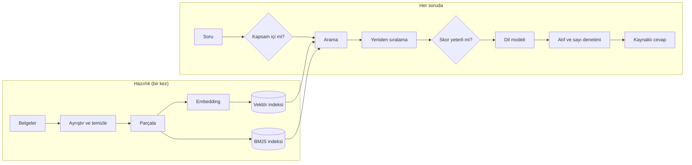

# RAG Rehberi: TÜBİTAK Mevzuatı Üzerinde Adım Adım

Bu belge RAG (Retrieval-Augmented Generation) üzerine genel bir derstir. RAG'de dil modeli
cevabı kendi hafızasından değil, o soru için belgelerden bulunup önüne konan metinlerden yazar.
Örnek olarak bu depodaki sistem kullanılıyor: TÜBİTAK mevzuatı ve başvuru süreçleri üzerine
kurulmuş, tamamen yerelde çalışan Türkçe bir soru-cevap sistemi. Rehber sistemin nasıl
kurulduğunu, nerelerde hata yapabileceğini, arama ve cevabın nasıl test edildiğini ve bütün
önlemlere rağmen hangi soruların yanlış cevaplandığını anlatıyor.

Her sayı depodaki bir çıktıdan alındı: deney raporları [`docs/sample-reports/`](sample-reports/),
soru bazındaki sonuçlar `artifacts/runs/<koşu>/per_question.jsonl`, test seti
[`eval/testset_v1.jsonl`](../eval/testset_v1.jsonl). Ondalık ayırıcı olarak
virgül (0,284), binlik ayırıcı olarak nokta (7.017) kullanıldı.

## İçindekiler

1. [RAG nedir, bu projede nasıl kuruldu?](#1-rag-nedir-bu-projede-nasıl-kuruldu)
2. [Parçalama, arama, sıralama](#2-parçalama-arama-sıralama)
3. [Bir RAG sisteminde neler yanlış gidebilir?](#3-bir-rag-sisteminde-neler-yanlış-gidebilir)
4. [Arama testi nasıl yapıldı?](#4-arama-testi-nasıl-yapıldı)
5. [Cevap testi nasıl yapıldı?](#5-cevap-testi-nasıl-yapıldı)
6. [Tüm bunlara rağmen yaşanan sorunlar](#6-tüm-bunlara-rağmen-yaşanan-sorunlar)
7. [Ne öğrendik?](#7-ne-öğrendik)
8. [Kendin çalıştır](#8-kendin-çalıştır)

---

## 1. RAG nedir, bu projede nasıl kuruldu?

Bir dil modeli yalnızca eğitildiği verideki bilgiyi bilir. Arama gibi bir araç kullanmadığı
sürece eğitim verisinin toplandığı tarihten sonra çıkan bir yönetmelik değişikliğini ya da
yeni bir çağrıyı bilemez; eğitim verisinde hiç yer almamış bir belgeyi ise hiç bilemez. Ayrıca
bir bilgiyi hangi maddeden aldığını söyleyemez ve bilmediği bir şeyi akıcı bir dille
uydurabilir. Mevzuatta en çok zarar veren uydurma da yanlış bir sayıdır
(oran, tutar, süre). RAG bu sorunu üç adımda ele alır:

1. **Retrieval (ilgili parçaları bulma):** Belgeler önceden küçük parçalara bölünüp aranabilir hâle getirilir (indekslenir).
   Soru gelince soruyla en ilgili parçalar bulunur.
2. **Augmentation (girdiyi parçalarla genişletme):** Bulunan parçalar numaralanır ve dil modeline verilen girdiye (prompt)
   eklenir.
3. **Generation (cevabı yazma):** Model cevabı yalnızca bu parçalara dayanarak yazar ve her bilginin yanına
   kaynağın numarasını `[n]` biçiminde koyar. Kaynaklar yetmiyorsa "bilgi bulunamadı" der.



Bütün bileşenler yerelde çalışıyor. Embedding modeli (metni sayılara çeviren model, Bölüm 2.2)
EmbeddingGemma 2; bir deneyde bunun yerine bge-m3 denendi. Yeniden sıralama modeli
bge-reranker-v2-m3, dil modeli `qwen3:4b`. Dil modeli Ollama üzerinde çalışıyor, vektörler
Qdrant veritabanında tutuluyor.

### 1.1 Belge koleksiyonu (corpus)

Sistemin içinde arama yaptığı belgelerin tamamına corpus deniyor. Depoda belgelerin kendisi
değil, manifest dosyaları tutuluyor (`data/manifests/*.json`). Manifest her belgenin indirme
adresini, indirme tarihini ve SHA-256 özetini (dosyanın parmak izi) listeler. `rag fetch`
belgeleri indirir ve özeti karşılaştırarak dosyanın değişmediğini doğrular.

| Kaynak | İçerik | Kayıt sayısı |
|---|---|---:|
| TÜBİTAK mevzuat sayfası | Uygulama esasları, yönetmelikler, yönergeler, idari ve mali esaslar | 60 |
| TÜBİTAK program sayfaları | 105 programın web sayfası | 105 |
| Program sayfalarındaki dosyalar | Çağrı metinleri, duyurular, sıkça sorulan sorular (SSS), başvuru ve rapor kılavuzları, bir üst limit tablosu (XLSX) | 115 |
| GİB mevzuat servisi | 5746 (Ar-Ge ve tasarım) ve 4691 (Teknoloji Geliştirme Bölgeleri) sayılı kanunların güncel metni | 2 |
| **Toplam** | | **282** |

282 kaydın 3'ü taranmış PDF olduğu için içinden metin çıkmıyor, 18'i ise yalnızca bağlantı
listesinden oluşan sayfalar. Bunlar çıkınca indekse 261 belge giriyor. Ar-Ge Merkezleri
Uygulama ve Denetim Yönetmeliği gibi indirilemeyen belgelere dayanan sorular, test setinde
"cevapsız" türüne konuldu.

### 1.2 Temizleme

PDF'ten çıkarılan metin çoğu zaman bozuk gelir. Bu corpus'ta sayfa altı yazıları cümlelerin
ortasına karışıyordu, eski fontlu PDF'lerde "kuruluşların" kelimesi `kurulufllar›n` olarak
çıkıyordu, Python'un `"I".lower()` dönüşümü de Türkçe "ı" yerine "i" veriyordu. Madde
sonlarındaki değişiklik notları (`(Değişik:29/12/2025-77YK-…)`) ve kanunlarda "değişmeden
önceki" hâliyle verilen eski ifadeler ana metinden ayrıldı. Ayrılmasaydı arama, yürürlükten
kalkmış bir hükmü de güncelmiş gibi getirebilirdi. Temizlemenin sonunda her bölüm sayfa
numarasını, madde numarasını, başlığını, belgedeki yerini (bölüm ve alt bölüm) ve sürüm tarihini
taşıyor.

### 1.3 Parçalara bölme

Arama bütün belgelerde değil, belgelerin bölündüğü parçalar (chunk) arasında yapılır. Bu
projede belgeler kendi doğal sınırlarından bölündü. Uzunluklar token cinsinden; token, modelin
metni böldüğü kelime ya da kelime parçasıdır.

| Parça türü | Sayı | Nasıl bölündü? |
|---|---:|---|
| Madde | 2.843 | Her madde bir parça. 450 token'dan uzun 419 madde, fıkra sınırlarından bölünerek 1.206 parçaya ayrıldı |
| SSS soru-cevap çifti | 287 | Her soru cevabıyla birlikte tek parça olarak tutuldu |
| Başlıklı bölüm, paragraf, tablo satırı | 3.887 | Program sayfaları, çağrı metinleri ve kılavuzlar bu sınırlardan bölündü |
| **Toplam** | **7.017** | |

Belirli bir programa ait parçalar o programın koduyla etiketlenir (1507, 4004 gibi). Corpus'ta
toplam 61 farklı program var. Bu etiket parçanın bağlam başlığına (aşağıda) yazılır; uygulamanın
REST API'sinde aramayı tek bir programla sınırlamak için de kullanılabilir.

Her parçanın iki metni vardır. `text` alanı kullanıcıya ve dil modeline gösterilen metindir.
`embed_text` alanı ise aramada kullanılan metindir ve başına bir bağlam başlığı eklenir. Bağlam
başlığı, parçanın hangi belgenin hangi bölümünden geldiğini yazar:

```text
TÜBİTAK 1507- … Uygulama Esasları (1507) › İkinci Bölüm – Destek Kapsamı › Madde 7 – Destek oranı ve sınırı
(1) Program kapsamında desteklenen projeler … "destek oranı" ile desteklenir. …
```

1501 ve 1507 programlarının 7. maddeleri aynı başlığı taşıyor. Başlıktaki "(1507)" etiketi bu
iki maddenin aramada birbirinden ayrılmasını sağlıyor.

---

## 2. Parçalama, arama, sıralama

Aynı 104 soruluk test setiyle altı farklı yapılandırma ölçüldü; her yapılandırmanın bir kez
çalıştırılmasına "koşu" diyoruz. Her koşu, karşılaştırıldığı koşudan yalnızca bir noktada
farklıdır. Tablodaki terimler bu bölümün alt başlıklarında açıklanıyor.

| Koşu | Parçalama | Arama | Yeniden sıralama | Karşılaştırıldığı koşu | Ne öğrenmek için? |
|---|---|---|---|---|---|
| v0 | Sabit pencere (512 token, 64 token örtüşme) | Dense (EmbeddingGemma 2) | Yok | — | En basit kurulumun sonucunu görmek; diğer koşular buna göre değerlendirilir |
| v0r | Sabit pencere | Dense (EmbeddingGemma 2) | bge-reranker-v2-m3 | v0 | Yeniden sıralamanın kötü parçalamayı telafi edip edemediğini görmek |
| v1 | Yapı bazlı + bağlam başlığı | Dense (EmbeddingGemma 2) | Yok | v0 | Parçaları madde sınırından bölmenin ve bağlam başlığı eklemenin etkisini görmek |
| v2 | Yapı bazlı + bağlam başlığı | Hibrit: dense + BM25, RRF ile birleştirme | Yok | v1 | Kelime aramasını (BM25) eklemenin katkısını görmek |
| v3 | Yapı bazlı + bağlam başlığı | Hibrit: dense + BM25, RRF ile birleştirme | bge-reranker-v2-m3 | v2 | Bütün iyileştirmeler birlikteyken sonucu görmek |
| v3b | Yapı bazlı + bağlam başlığı | Hibrit: dense (bge-m3) + BM25, RRF ile birleştirme | bge-reranker-v2-m3 | v3 | Embedding modelini değiştirmenin etkisini görmek |

### 2.1 Parçalama: sabit pencere ve yapı bazlı

Sabit pencere yöntemi metni içeriğine bakmadan her 512 token'da bir keser ve 4.193 parça
üretir. Yapı bazlı parçalama ise madde, SSS çifti ve başlıklı bölüm sınırlarını izler; 7.017
parça üretir, parçaların medyan uzunluğu 237 token'dır. Sabit pencereyi kurmak kolaydır, ama
bir pencereye birkaç madde birden girer, program adı çoğu zaman pencerenin içinde geçmez ve
pencere, başladığı yerdeki maddenin numarasını taşır (örneği Bölüm 6.1'de).

### 2.2 Dense arama, BM25 ve hibrit arama

**Dense arama.** Embedding modeli bir metni bir sayı dizisine (vektöre) çevirir; anlamca yakın
metinlerin ("destek oranı" ile "hibe oranı") vektörleri de yakın olur. Bu vektörlerle yapılan
aramaya dense arama denir. Farklı kelimelerle sorulan soruları iyi yakalar, ama "1507", "1501"
ve "1512" gibi program kodlarını birbirinden zor ayırır.

**BM25.** Klasik bir kelime arama yöntemidir. Nadir bir kelimenin ("1507") eşleşmesine, sık bir
kelimenin ("proje") eşleşmesinden çok daha fazla ağırlık verir. Türkçe için iki ayar gerekti:
Türkçe kurallarıyla küçük harfe çevirme (büyük "İ" küçük "i", büyük "I" küçük "ı" olur) ve kök
bulma ("projelerin" ve "projeler" ikisi de "proje" olur). Sayılar köklenmez. Aramada yok sayılan
sık kelimeler listesine "az" bilerek konmadı, çünkü mevzuatta "en az" ile "en fazla" zıt
anlamlıdır.

**Hibrit arama (RRF).** Hibrit arama, dense arama ile BM25'in sonuçlarını birleştirir. Dense
skorlar 0,3 ile 0,8, BM25 skorları 0 ile 40 arasında değiştiği için doğrudan toplanamaz.
Reciprocal Rank Fusion (RRF) yalnızca parçanın her listedeki sırasına bakar:
`skor = Σ 1 / (60 + sıra)`, yani her listedeki sıraya 60 eklenip tersi alınır ve bunlar toplanır.
Örneğin dense listesi `[a, b, c]`, BM25 listesi `[b, a, d]` ise iki listede de görünen a ve b
yaklaşık 0,0325, yalnızca bir listede görünen c ve d ise 0,0159 alır. Her iki yöntemden 60 aday
alınır, birleştirilir ve ilk 30 aday yeniden sıralamaya gönderilir.

### 2.3 Yeniden sıralama (reranker)

Embedding modeli soruyu ve parçayı ayrı ayrı vektöre çevirir, ikisini birlikte okumaz. Yeniden
sıralama modeli (reranker) ise soru ile parçayı birlikte okur ve parçanın soruyu ne kadar
cevapladığına bir skor verir; bu tür modellere cross-encoder denir. Daha isabetlidir, ama her
aday için modeli ayrıca çalıştırmak gerekir. Bu yüzden iş iki aşamaya bölünür: hızlı ilk arama
30 aday getirir, reranker bu 30 adayı sıralar ve ilk 5 parça dil modeline gider.

Reranker'ın bedeli, cevabın daha geç gelmesidir. RTX 3080 GPU'da toplam cevap süresi, önce
medyan (p50), sonra isteklerin %95'inin altında kaldığı süre (p95) olarak şöyle: reranker'sız
hibrit aramada (v2) 1.126 / 2.111 ms, reranker eklenince (v3) 1.771 / 2.811 ms, aynı kurulumda
embedding modeli bge-m3 olunca (v3b) 2.923 / 5.251 ms. GPU olmadan, yalnızca işlemciyle reranker 30 adayı
ortalama 19,2 saniyede sıralıyor; bu yüzden Docker'ın CPU modunda yalnızca ilk 6 aday yeniden
sıralanıyor.

### 2.4 Cevap üretimi ve denetimler

Doğru parça gelse bile model kaynakta olmayan bir bilgi ekleyebilir, yanlış kaynağa atıf
yapabilir ya da kaynak yokken cevap uydurabilir. Bu yüzden akışa hızlı çalışan ve kuralı açık
denetimler eklendi:

| Adım | Ne yapar? | Bu adımda durursa kullanıcı ne görür? |
|---|---|---|
| 1. Kapsam kontrolü | Soruda terim sözlüğündeki bir kelime (tübitak, ar-ge, kobi, program kodları …) geçiyor mu diye bakar. Geçmiyorsa sorunun kapsamda olup olmadığını dil modeline sorar | "Kapsam dışı" cevabı; arama hiç yapılmaz |
| 2. Arama ve yeniden sıralama | 30 aday getirir ve sıralar; ilk 5 parça sonraki adıma geçer | Bu adımda durmaz |
| 3. Skor eşiği | En iyi parçanın skoru belirlenen eşiğin altındaysa dil modeli hiç çağrılmaz | "Bilgi bulunamadı" |
| 4. Dil modeli | Cevabı belirli bir JSON yapısında yazar: `cevaplanabilir`, `cevap` ve `atiflar` alanları | Model kaynaklarda bilgi olmadığını söylerse "bilgi bulunamadı" |
| 5. Atıf denetimi | Cevapta hiç atıf yoksa ya da modele verilmemiş bir kaynağa atıf varsa cevabı reddeder | "Bilgi bulunamadı" |
| 6. Sayı denetimi | Cevaptaki her sayının kaynak metinlerde geçip geçmediğine bakar | Dayanağı olmayan sayının geçtiği cümle silinir; geriye cümle kalmazsa "bilgi bulunamadı" |

Kaynaklar prompt'a `<kaynaklar>` etiketi içinde, belge adı, madde, program ve sürüm tarihiyle
birlikte konur. Ollama'ya cevabın JSON yapısını tarif eden bir şema verilince model bu yapının
dışına çıkamaz. `qwen3:4b` şemayla yapılan 30 denemenin 30'unda geçerli JSON verdi, şemasız 16
denemenin yalnızca 3'ünde.

Sayı denetiminin eklenme nedeni geliştirme sırasında görülen bir hataydı. "1507'de destek oranı
nedir ve proje süresi en fazla kaç aydır?" sorusunda kaynaklarda proje süresi geçmiyordu, ama
model beş denemenin beşinde "proje süresi en fazla 24 aydır [1]" yazdı. Cümlenin geçerli bir
atfı olduğu için atıf denetimi bunu yakalayamazdı; prompt'a kural eklemek de sonucu değiştirmedi.
Bu yüzden denetim kodla yapıldı: cevaptaki ve kaynaklardaki sayılar aynı biçime çevrilir
(`%75` ile `yüzde 75`, `on sekiz ay` ile `18 ay` aynı sayılır) ve karşılaştırılır. Mevzuat
sorusunda yanlış bir rakamı kaynak göstererek vermek, hiç cevap vermemekten daha zararlıdır.

---

## 3. Bir RAG sisteminde neler yanlış gidebilir?

Bir RAG sistemi iki aşamada hata yapabilir. Arama aşamasında yanlış ya da eksik parça getirir;
üretim aşamasında doğru parçayı aldığı hâlde yanlış cevap yazar. Bu yüzden iki aşama ayrı ayrı
test edilmelidir: doğru parçalar gelse de model yanlış cevap verebilir, yanlış bir cevabın
nedeni de her zaman arama olmayabilir. Aşağıdaki iki tablo genel bir kontrol listesi olarak
okunabilir; örnek soruların çoğu bu projenin test setinden alındı.

### 3.1 Arama hataları

| Ne yanlış gider? | Örnek soru | Bu projede nasıl ölçülüyor? | Alınan önlem |
|---|---|---|---|
| Doğru parça hiç gelmiyor | "3001 Başlangıç Ar-Ge projeleri en fazla kaç ay desteklenir?" | Recall@k (Bölüm 4.3) ve kanıtın 30 adayın hiçbirinde olmadığı soru sayısı | Yapı bazlı parçalama, hibrit arama |
| Doğru parça geliyor ama alt sıralarda kalıyor | "1512 Girişimcilik Destek Programında Aşama 2 iş planı faaliyetleri en fazla ne kadar sürebilir?" | Recall@5 ile Recall@10 arasındaki fark, MRR ve kanıtın ilk göründüğü sıra | Reranker |
| Benzer bir programın parçası öne geçiyor | "4008 projesinde her bir etkinlik dönemi en az kaç gün olmalı?" (4004, 4005 ve 4007 çağrıları çok benzer) | Parçanın isabet sayılması için beklenen belgeden gelmesi gerekiyor | Bağlam başlığında program kodu, BM25 |
| Belgenin eski sürümü geliyor | "1707 Sipariş Ar-Ge çağrısında proje bütçesi üst sınırı ne kadar?" | "Sürüm" türünde 10 soru; beklenen kanıt en güncel belgede | Parçalarda sürüm tarihi |
| Parça sınırı kanıtı ortadan bölüyor | Cevabı taşıyan cümle iki parçaya bölünürse hiçbir parça cevabı tek başına içermez | İsabet için alıntının tamamının tek parçada geçmesi gerekiyor; bölünen kanıt "bulunamadı" sayılır | — |
| Parçanın başlığı ya da madde numarası yanlış | 1507'deki %75 cümlesi "Madde 5" etiketli bir pencerede duruyor | Metrikler bunu ölçmüyor; yanlış madde numaraları ayrıca sayıldı (Bölüm 6.1). Başlık kalitesi test edilmiyor | Yapı bazlı parçalamada her parça kendi maddesini taşıyor |
| Birden çok belge gerektiren soruda bir parça eksik kalıyor | "1004 Mükemmeliyet Merkezi programında KOBİ ortağa uygulanacak destek oranı ve araştırma programının azami süresi nedir?" | "Çok belge" türünde 16 soru; her alıntı ayrı sayılıyor | — |
| Soru eş anlamlı bir kelimeyle ya da kısaltmayla soruluyor | "Teknoparkta yönetici şirketin kurucuları arasında kimlerin bulunması zorunludur?" (kanunda "Teknopark" yerine "Bölge" geçiyor) | Sorular kullanıcının kullanacağı kelimelerle yazıldı (Teknopark, PTİ, KOBİ); bunun için ayrı bir soru türü yok | Dense arama |
| Program belirtilmeyen soruda yalnızca tek bir programın parçaları geliyor | "Proje bütçesinin üst limiti ne kadar?" | "Belirsiz" türünde 10 soru; her programın kanıtı ayrı sayılıyor | — |
| Cevabı olmayan soruda konuya benzeyen parçalar geliyor | "2211 Yurt İçi Doktora Bursu kapsamında ayda kaç TL burs ödeniyor?" (corpus'ta yok) | "Cevapsız" türünde 15 soru | Skor eşiği |

### 3.2 Cevap hataları

| Ne yanlış gider? | Örnek soru | Bu projede nasıl ölçülüyor? | Alınan önlem |
|---|---|---|---|
| Uydurma, özellikle sayı, tutar, oran ya da süre | "1001 projelerinde 2026 yılı için proje yürütücüsüne ödenecek aylık PTİ üst sınırı kaç TL?" (corpus'ta yok) | Cevapsız sorularda "uydurma" etiketi; beklenen sayıların cevapta geçip geçmediği | Sayı denetimi |
| Kaynakta olmayan bir bilgiyi modelin genel bilgisinden eklemek | "Ufuk Avrupa Marie Skłodowska-Curie doktora sonrası bursunda araştırmacıya aylık kaç avro ödeniyor?" | Her cevapta "kaynağa sadık mı?" etiketi | Prompt'taki kural, sayı denetimi |
| Atıfsız cevap ya da yanlış kaynağa atıf | "Teknoparktaki yazılım kazançlarına tanınan vergi istisnası ile 5746 sayılı Kanun kapsamındaki destekler hangi tarihe kadar geçerli?" | Sadakat etiketi, atıf kesinliği (Bölüm 5.3) | Atıf denetimi |
| Bir koşulu tersine çevirmek | "Ulusal patent başvuruları hâlâ destekleniyor mu?" | Evet/hayır cevaplı sorularda doğruluk | Yok |
| Birden fazla programı karıştırmak | "2224-A desteğinden aynı yıl içinde ikinci kez yararlanabilir miyim?" | Doğruluk | Bağlam başlığında program kodu |
| Program belirtilmeyen soruda tek bir programı varsaymak | "Destek oranı yüzde kaç?" | Belirsiz sorular ve cevabın programlara ayrılıp ayrılmadığını sayan kontrol | Yok |
| Eski sürümdeki değeri vermek | "BiGG Yatırım 2026-2 çağrısında TÜBİTAK BİGG Fonu girişim şirketine ne kadar yatırım yapıyor?" | Sürüm soruları | Kaynakların sürüm tarihi prompt'ta yazıyor |
| Cevabı olan soruya gereksiz yere "bilgi bulunamadı" demek | "5746 sayılı Kanuna göre doktoralı Ar-Ge personelinin gelir vergisi stopajının yüzde kaçı terkin edilir?" | Gereksiz ret sayısı ve hatanın aramada mı üretimde mi olduğu | — |
| Kapsam dışı bir soruya cevap vermek ya da kapsamdaki bir soruyu reddetmek | "Elimdeki birikimi borsada hangi hisselere yatırmalıyım?" | "Kapsam dışı" türünde 10 soru | Kapsam kontrolü |
| Sorudaki yanlış bir varsayımı onaylamak | "1507 programında 2027 yılı için belirlenen proje bütçesi üst limiti kaç TL?" | Bazı cevapsız ve sürüm soruları bu kalıpta yazıldı; ayrı bir soru türü yok | — |
| Birkaç parçalı bir sorunun bir kısmını atlamak | "Büyük ölçekli bir firmayız; 1501 programından hangi destek oranıyla yararlanabiliriz?" | Çok belge soruları, doğruluk | — |
| Kaynak metne gömülü bir talimata uymak (prompt enjeksiyonu) | Kaynak metnin içine yerleştirilmiş, modele başka bir iş yaptırmaya çalışan bir cümle | Test setinde yok. Geliştirme sırasında bir enjeksiyon senaryosu 5 kez denendi, model hiçbirinde talimata uymadı | Kaynaklar prompt'ta ayrı bir etiket içinde veriliyor |
| Cevabın JSON yapısının bozulması | Belirli bir soruya bağlı değil | Koşulardaki sistem hatası sayısı (altı koşunun hepsinde 0) | JSON şeması |

Test setinin hiç kapsamadığı iki konu var. Birincisi sohbet geçmişi: her soru tek başına
cevaplanıyor. İkincisi kullanıcıya özel bilgi isteyen sorular; bunun için yalnızca bir örnek
var: "121M345 numaralı 1001 projemin ara rapor değerlendirmesi ne durumda?"

---

## 4. Arama testi nasıl yapıldı?

### 4.1 Test seti

`eval/testset_v1.jsonl` 104 soru içeriyor. Sorular ayrıştırılmış belgeler okunarak, bir
kullanıcının soracağı şekilde yazıldı.

| Tür | Tanım | Soru sayısı |
|---|---|---:|
| Tek belge | Cevap tek bir belgede (oran, süre, tutar, koşul) | 43 |
| Çok belge | Cevap için iki belgenin birlikte okunması gerekir (ör. 5746 sayılı Kanun ve 1501 Uygulama Esasları) | 16 |
| Sürüm | Belgelerde eski ve yeni değer birlikte geçiyor; beklenen cevap en güncel kaynaktaki değer | 10 |
| Belirsiz | Soruda program belirtilmemiş, cevap programa göre değişiyor | 10 |
| Cevapsız | Konu kapsamda ama cevabı corpus'ta yok | 15 |
| Kapsam dışı | TÜBİTAK ile ilgisiz (hava durumu, futbol, yemek tarifi …) | 10 |

Cevaplanabilir her soruda beklenen cevap, beklenen belgeler, beklenen sayılar ve 1 ila 3 kanıt
alıntısı yazılı; toplam 117 alıntı var. Soruların bir insan tarafından gözden geçirilmesi henüz
tamamlanmadı ([`eval/review_queue.md`](../eval/review_queue.md)).

### 4.2 Kanıt alıntısıyla aramayı parçalamadan bağımsız ölçmek

Kanıt alıntısı, cevabı kanıtlayan ve belgede kelimesi kelimesine geçen kısa bir cümledir.
Örneğin "KOBİ olarak 1507 programından proje desteği alırsam TÜBİTAK harcamalarımın en fazla
yüzde kaçını karşılar?" sorusunun alıntısı 1507 Uygulama Esasları'ndan (`mevzuat-031`) alınmış
şu cümledir: "Bu programda uygulanacak destek oranı her dönem için en fazla %75 olarak
belirlenmiştir."

Test setinde doğru parçanın kimliği yerine bu alıntı tutuluyor, çünkü sabit pencere ile madde
bazlı parçalama farklı parçalar üretiyor ve "doğru parça" yapılandırmaya göre değişiyor. Alıntı
ise belgenin kendisine bağlı; böylece aynı test seti her parçalama yöntemini eşit koşullarda
ölçüyor. İsabet metin karşılaştırmasıyla bulunduğu için sonuç kimsenin yorumuna bağlı değil.
Her alıntının belgede birebir geçtiği de otomatik olarak kontrol ediliyor.

Getirilen bir parça şu iki koşulu sağlarsa o alıntı için isabet sayılır: parça alıntının geldiği
belgeden olmalı ve metni alıntının tamamını içermeli. Karşılaştırmadan önce iki metin de Türkçe
kurallarıyla küçük harfe çevrilir; boşluk, tırnak ve tire işaretlerinin farklı biçimleri tek
biçime indirilir. Şu farklar ise bilerek eşit sayılmaz: "% 60" ile "%60", "1.350.000" ile
"1350000", "on sekiz" ile "18".

### 4.3 Metrikler ve küçük bir örnek

- **Recall@k:** Bir sorunun kanıt alıntılarından kaçının ilk k parçada bulunduğunu gösterir;
  sonra bütün soruların ortalaması alınır. Recall@5, dil modeline giden ilk 5 parçaya bakar.
- **MRR (Mean Reciprocal Rank):** İlk isabetli parçanın sırasının tersidir: 1. sıradaysa 1,
  2. sıradaysa 0,5, 3. sıradaysa 0,33, hiç yoksa 0. Sonra bütün soruların ortalaması alınır.
- **Belge isabeti@k:** Beklenen belgelerden en az birinin ilk k parça arasında olup olmadığına
  bakar.

Ölçüm, cevaplanabilir 79 sorunun 77'si üzerinde yapıldı. Kalan 2 soruyu kapsam kontrolü
yanlışlıkla kapsam dışı saydığı için bu sorularda arama hiç yapılmadı.

v3'ten (yapı bazlı parçalama, hibrit arama ve reranker) gerçek bir örnek: "1004 Mükemmeliyet
Merkezi programında KOBİ ortağa uygulanacak destek oranı ve araştırma programının azami süresi
nedir?" sorusunun iki alıntısı şu sıralarda bulundu.

| Alıntı | Sıra |
|---|---:|
| "KOBİ'lerin bütçesinin %75'ine kadar" (1004 Usul ve Esasları) | 6 |
| "Süre en fazla 48 ay olabilir." (1004 program sayfası) | 3 |

Bu soru için Recall@5 = 1/2 = 0,5, Recall@10 = 2/2 = 1 ve MRR katkısı 1/3 ≈ 0,33. Dil modeline
yalnızca ilk 5 parça gittiği için model KOBİ oranını hiç görmedi ve "kaynaklarda yok" dedi.
Recall@5 ile Recall@10 arasındaki fark, bu şekilde ilk 5'in hemen dışında kalan kanıtları
gösterir.

### 4.4 Sonuçlar

| Koşu | Yöntem | Recall@5 | Recall@10 | MRR | Belge isabeti@5 | Belge isabeti@10 |
|---|---|---:|---:|---:|---:|---:|
| v0 | Sabit pencere, dense | 0,284 | 0,355 | 0,241 | 0,610 | 0,701 |
| v0r | Sabit pencere, dense + reranker | 0,487 | 0,513 | 0,401 | 0,675 | 0,766 |
| v1 | Yapı bazlı + bağlam başlığı, dense | 0,439 | 0,554 | 0,419 | 0,675 | 0,818 |
| v2 | Yapı bazlı + bağlam başlığı, hibrit (RRF) | 0,543 | 0,617 | 0,477 | 0,805 | 0,870 |
| v3 | Yapı bazlı + bağlam başlığı, hibrit + reranker | 0,699 | 0,751 | 0,612 | 0,831 | 0,857 |
| v3b | v3 ile aynı, embedding bge-m3 | **0,727** | **0,784** | **0,623** | **0,844** | **0,896** |

Aşağıdaki tablo, her katmanın hangi tür hatayı düzelttiğini gösteriyor. Her soru için kanıtın
30 aday içinde ilk göründüğü sıraya bakıldı (77 soru). Son sütun, kanıtın 30 adayın hiçbirinde
olmadığı soruları sayıyor.

| Koşu | 1. sırada | 2.–5. sırada | 6.–30. sırada | 30 adayda yok |
|---|---:|---:|---:|---:|
| v0 – sabit pencere, dense | 11 | 16 | 21 | 29 |
| v0r – sabit pencere, dense + reranker | 24 | 19 | 5 | 29 |
| v1 – yapı bazlı + bağlam başlığı, dense | 25 | 14 | 26 | 12 |
| v2 – yapı bazlı + bağlam başlığı, hibrit | 28 | 21 | 16 | 12 |
| v3 – yapı bazlı + bağlam başlığı, hibrit + reranker | 38 | 22 | 5 | 12 |
| v3b – v3 ile aynı, embedding bge-m3 | 38 | 24 | 7 | 8 |

Reranker, 6. ile 30. sıra arasındaki kanıtları ilk 5'e taşıyor: bu sütun v0'dan v0r'ye 21'den
5'e, v2'den v3'e 16'dan 5'e indi. Ama reranker yalnızca 30 adayın içinde olan bir parçayı
yukarı taşıyabilir; v0'dan v0r'ye "30 adayda yok" sütunu 29'da kaldı. Bu sütunu küçülten şeyler
parçalama yöntemi (v0'dan v1'e 29'dan 12'ye) ve embedding modeli (v3'ten v3b'ye 12'den 8'e)
oldu.

Soru türüne göre Recall@5 (koşuların yöntemleri yukarıdaki tablolarda):

| Tür | v0 | v0r | v1 | v2 | v3 | v3b |
|---|---:|---:|---:|---:|---:|---:|
| Tek belge (43) | 0,357 | 0,595 | 0,595 | 0,679 | 0,833 | 0,881 |
| Çok belge (16) | 0,240 | 0,469 | 0,240 | 0,458 | 0,625 | 0,625 |
| Sürüm (10) | 0,200 | 0,400 | 0,500 | 0,600 | 0,800 | 0,800 |
| Belirsiz (10) | 0,111 | 0,111 | 0,000 | 0,000 | 0,093 | 0,111 |

Bu metriğin gözden kaçırdığı bir durum var: aynı bilgi birden çok belgede geçebilir. "KOBİ
olarak 1507 programından …" sorusunda beklenen kanıt 1507 Uygulama Esasları'nda; hibrit aramalı
v2, v3 ve v3b'de bu madde 30 adayın içinde bile yok. Ama ilk sıralara gelen 1507 program sayfası
ve SSS aynı %75 oranını söylüyor ve cevap doğru. Metrik bu soruyu yine de "bulunamadı" sayıyor.
Belge isabeti bu yüzden ayrıca raporlanıyor.

---

## 5. Cevap testi nasıl yapıldı?

### 5.1 Hangi soru cevaplanmalı, hangisi reddedilmeli?

| Soru türleri | Soru sayısı | Beklenen davranış |
|---|---:|---|
| Tek belge, çok belge, sürüm, belirsiz | 79 | Doğru ve kaynaklı cevap; belirsiz sorularda cevabı programlara göre ayırarak |
| Cevapsız | 15 | "Bilgi bulunamadı" |
| Kapsam dışı | 10 | "Kapsam dışı" |

Her yapılandırma 104 sorunun hepsini cevapladı; altı koşuda toplam 624 cevap var. Koşular,
modelin cevaplarındaki rastgeleliği kapatan `temperature: 0` ayarıyla birer kez yapıldı.

### 5.2 Cevapların tek tek değerlendirilmesi

624 cevabın tamamı Claude (Opus) ile tek tek değerlendirildi. Her soru için soru metni, beklenen
cevap, sistemin cevabı ve cevabın atıf yaptığı kaynak metinleri verildi.

| Soru grubu | Neye bakıldı? | Verilen etiket |
|---|---|---|
| Cevaplanabilir, sistem cevap verdi | Cevap beklenen cevapla özünde aynı mı? Cevaptaki her bilgi atıf yapılan kaynakta geçiyor mu? | doğru ya da yanlış; kaynağa sadık ya da değil |
| Cevaplanabilir, sistem reddetti | Kanıt ilk 5 kaynakta var mıydı? | gereksiz ret; hatanın yeri (arama, üretim ya da belirsiz) |
| Cevapsız ve kapsam dışı | Sistem cevap vermekten kaçındı mı, cevap verdiyse dayanağı var mı? | doğru ret ya da uydurma |

Cevap metninde "kaynaklarda bu bilgi yok" diyen bir cevap da doğru ret sayıldı. Değerlendirmede
her kaynağın yaklaşık ilk 1.000 karakteri gösterildi. Uzun maddelerde dayanak bu sınırın dışında
kaldıysa cevap "kaynağa sadık değil" sayılmış olabilir; bu yüzden sadakat değerlerini temkinli
okumak gerekir. Uygulamada değerlendirme için yerel bir hakem modeli de seçilebiliyor; bu
rehberdeki sonuçlar ise yukarıda anlatılan Claude değerlendirmesinden geliyor.

### 5.3 Kural tabanlı kontroller

Aşağıdaki kontroller değerlendiriciye gerek kalmadan kodla hesaplanıyor. Sütunlar: v0 sabit
pencere ve dense arama, v0r buna reranker eklenmiş hâli, v1 yapı bazlı parçalama ve dense arama,
v2 yapı bazlı parçalama ve hibrit arama, v3 buna reranker eklenmiş hâli, v3b v3'ün bge-m3'lü hâli.

| Kontrol | Ne ölçer? | v0 | v0r | v1 | v2 | v3 | v3b |
|---|---|---:|---:|---:|---:|---:|---:|
| Beklenen sayılar cevapta (69 sorudan) | Beklenen sayıların hepsinin cevapta geçtiği soru sayısı | 25 | 34 | 28 | 35 | 40 | 39 |
| Atıf kesinliği | Atıf yapılan parçalardan beklenen belgeden gelen ya da kanıtı içerenlerin oranı | 0,309 | 0,368 | 0,448 | 0,472 | 0,421 | 0,463 |
| Belirsiz soruda programlara ayırma | Cevabın en az iki programı andığı belirsiz soru sayısı | 0 | 0 | 0 | 0 | 0 | 0 |
| Sayı denetiminin reddettiği soru | Dayanağı olmayan bir sayı yüzünden reddedilen soru sayısı | 4 | 1 | 6 | 3 | 1 | 3 |
| Sistem hatası | Bozuk JSON ya da model hatası sayısı | 0 | 0 | 0 | 0 | 0 | 0 |

Atıf kesinliğinin düşük çıkmasının bir nedeni, modelin çoğu zaman `[1, 2, 3, 4, 5]` gibi bütün
kaynaklara birden atıf yapması. Aynı bilgiyi söyleyen ama beklenen belgeler listesinde olmayan
bir program sayfası da bu hesapta isabetsiz sayılıyor.

### 5.4 Sonuçlar

| Koşu | Yöntem | Doğruluk | Sadakat | Doğru ret (25) | Uydurma | Gereksiz ret |
|---|---|---:|---:|---:|---:|---:|
| v0 | Sabit pencere, dense | 0,380 (30/79) | 0,532 | 0,760 | 6 | 6 |
| v0r | Sabit pencere, dense + reranker | 0,557 (44/79) | 0,554 | 0,680 | 8 | 4 |
| v1 | Yapı bazlı + bağlam başlığı, dense | 0,418 (33/79) | 0,574 | 0,840 | 4 | 9 |
| v2 | Yapı bazlı + bağlam başlığı, hibrit | 0,519 (41/79) | 0,696 | 0,760 | 6 | 6 |
| v3 | Yapı bazlı + bağlam başlığı, hibrit + reranker | **0,633** (50/79) | **0,806** | 0,800 | 5 | 5 |
| v3b | v3 ile aynı, embedding bge-m3 | 0,620 (49/79) | 0,761 | **0,880** | **3** | 6 |

- **Doğruluk:** Doğru cevaplanan soruların cevaplanabilir 79 soruya oranı. Gereksiz ret yanlış
  cevap sayılır.
- **Sadakat:** Cevap verilen sorularda, her bilgisi atıf yapılan kaynakta geçen cevapların oranı.
- **Doğru ret:** Cevapsız 15 ve kapsam dışı 10 soruda sistemin doğru davrandığı soruların oranı.
- **Uydurma:** Cevabı corpus'ta olmayan bir soruya dayanaksız cevap verilen soru sayısı.
- **Gereksiz ret:** Cevabı olan bir soruya "bilgi bulunamadı" ya da "kapsam dışı" denen soru
  sayısı.

Soru türüne göre doğru cevap sayısı (koşuların yöntemleri yukarıdaki tabloda):

| Tür | v0 | v0r | v1 | v2 | v3 | v3b |
|---|---:|---:|---:|---:|---:|---:|
| Tek belge (43) | 23 | 32 | 26 | 29 | 34 | 34 |
| Çok belge (16) | 4 | 8 | 3 | 6 | 9 | 8 |
| Sürüm (10) | 3 | 4 | 4 | 6 | 7 | 7 |
| Belirsiz (10) | 0 | 0 | 0 | 0 | 0 | 0 |
| Cevapsız (15), doğru ret | 9 | 7 | 11 | 9 | 10 | 12 |
| Kapsam dışı (10), doğru ret | 10 | 10 | 10 | 10 | 10 | 10 |

Bu tablolardan çıkan sonuçlar:

- Arama iyileştikçe cevaplar da iyileşti, ama aynı ölçüde değil. Sabit pencereden (v0) yapı
  bazlı parçalamaya (v1) geçince Recall@5 0,284'ten 0,439'a çıktı; doğru cevap sayısı ise
  yalnızca 30'dan 33'e çıktı.
- Belirsiz sorularda doğruluk her koşuda 0. Model hiçbir yapılandırmada cevabı programlara göre
  ayırmadı.
- Reranker, cevabı olmayan sorularda modeli cevap vermeye itebiliyor. Sabit pencereli kuruluma
  reranker eklenince (v0'dan v0r'ye) doğru ret 9'dan 7'ye düştü; daha ilgili görünen kaynaklar
  modeli cevabı olmayan sorulara da cevap vermeye yöneltti.
- Gereksiz retlerin yalnızca küçük bir kısmı aramadan kaynaklanıyor. Altı koşudaki 36 gereksiz
  retin 9'unda hata aramada (kanıt ilk 5'te yok), 16'sında üretimde ya da denetimlerde (kanıt
  ilk 5'te var); 11'inde hatanın yeri belirsiz.

Bu farkları yorumlarken test setinin küçük olduğu unutulmamalı. Cevaplanabilir 79 soruda tek
bir soru doğruluğu yaklaşık 1,3 yüzde puan, 25 ret sorusunda ise 4 yüzde puan değiştirir. v0
(sabit pencere, dense) ile v3 (yapı bazlı, hibrit, reranker) arasındaki farklar (Recall@5'te
+0,415, doğrulukta +0,253) birkaç soruyla açıklanamayacak kadar büyük. v3 ile v3b (aynı kurulum,
embedding modeli bge-m3) arasındaki fark ise bir iki soru: doğru cevap 50'ye 49, doğru ret 20'ye
22. "bge-m3 daha iyi" demek için daha büyük bir test seti gerekir; v3b'nin daha yavaş olduğu ise
kesin (Bölüm 2.3).

---

## 6. Tüm bunlara rağmen yaşanan sorunlar

Bu bölümdeki her örnek test setindeki gerçek bir sorudur. Her örnekte sistemin getirdiği parçalar
ya da yazdığı cevap, doğru cevap, hatanın nedeni ve bugünkü durumu veriliyor. Parantez içindeki
kimlik (q001 gibi) sorunun test setindeki numarası. Başka bir koşu yazılmadıysa örnek, en iyi
sonuç veren v3 koşusundandır (yapı bazlı parçalama, hibrit arama ve reranker).

### 6.1 Arama sorunları

**1. Pencere yanlış maddenin numarasını taşıyor.** "KOBİ olarak 1507 programından proje desteği
alırsam TÜBİTAK harcamalarımın en fazla yüzde kaçını karşılar?" (q001)

- **Ne geldi (v0, sabit pencere ve dense arama):** %75 cümlesini içeren pencere 28. sıradaydı ve
  "1507 Uygulama Esasları, Madde 5" etiketini taşıyordu. Pencere Madde 5'in başında başlıyor,
  Madde 6 ve 7'yi de içine alıyordu. Cümle aslında Madde 7'de.
- **Neden:** Her pencere, başladığı yerdeki maddenin numarasını taşır. Kanıtı bir maddenin içinde
  duran 47 alıntının 35'inde, alıntıyı içeren hiçbir pencere doğru madde numarasını taşımıyordu.
  Üç madde tek pencerede olunca embedding de üç konunun karışımı olur.
- **Durum:** Çözüldü. Yapı bazlı parçalamada (v1 ve sonrası) her parça kendi maddesini taşıyor.

**2. Kanıt 30 adayın içinde ama çok aşağıda.** "1512 Girişimcilik Destek Programında Aşama 2 iş
planı faaliyetleri en fazla ne kadar sürebilir?" (q010)

- **Ne geldi (v0, sabit pencere ve dense arama):** İlk 5 parçanın dördü, 1512 Aşama 1 uygulayıcı
  kuruluş çağrısının bölümleriydi; kanıt 29. sıradaydı. Cevap "en fazla 12 ay sürebilir [1, 2, 5]"
  oldu. Doğrusu: ek süreler dahil en fazla 18 ay (1512 Esasları).
- **Neden:** Dense arama, içinde "1512" ve "Aşama" geçen her parçayı soruya yakın buldu.
- **Durum:** Çözüldü. Aynı kuruluma reranker eklenince (v0r) kanıt 2. sıraya çıktı ve cevap "en
  fazla 18 ay sürebilir [2]" oldu.

**3. Benzer programların parçaları öne geçiyor.** "4008 projesinde her bir etkinlik dönemi en az
kaç gün olmalı?" (q033)

- **Ne geldi (v1, yapı bazlı parçalama ve yalnızca dense arama):** İlk 5'te 4005'in "Etkinlik
  Süresi" bölümü ile 4008, 4004 ve 4007 çağrılarının "Çağrı Takvimi" bölümleri vardı; kanıt 16.
  sıradaydı. Cevap "en az 1 gün olmalıdır" oldu. Doğrusu: en az 4 gün (4008 çağrı metni).
- **Neden:** Bilim ve toplum programlarının çağrıları neredeyse aynı şablonla yazılmış.
- **Durum:** Çözüldü. Hibrit aramada (v2) BM25 kanıtı 4. sıraya taşıdı ve cevap "en az 4 gün [4]"
  oldu. Reranker eklenen v3'te kanıt 1. sırada.

**4. Belgenin eski sürümü geliyor, güncel belge gelmiyor.** "1707 Sipariş Ar-Ge çağrısında proje
bütçesi üst sınırı ne kadar?" (q059). Sabit pencereli v0'da 2024 tarihli üst limit tablosu geldi,
güncel 2026-3 çağrı metni 30 adayda yoktu; cevap "2022 yılında açılan çağrılarda 5000000 TL'dir"
oldu. Doğrusu 10.000.000 TL. Sorun çözüldü: yapı bazlı parçalamaya geçilen v1'den itibaren güncel
çağrı ilk 5'te.

**5. Birkaç parçalı soruda bir parça ilk 5'in hemen dışında kalıyor.** "1004 Mükemmeliyet Merkezi
programında KOBİ ortağa uygulanacak destek oranı ve araştırma programının azami süresi nedir?"
(q053)

- **Ne geldi:** Süre kanıtı 3., KOBİ oranı kanıtı 6. sıradaydı. İlk 5'te ise kamu kurumları için
  %100 oranını söyleyen madde vardı. Model "kaynaklarda yok" dedi. Reranker'sız v2'de ise %100
  oranını KOBİ'lere uyguladı. Doğrusu: KOBİ'ler için %75'e kadar, süre en fazla 48 ay.
- **Neden:** Dil modeline yalnızca ilk 5 parça gidiyor.
- **Durum:** Açık. Soruyu alt sorulara bölmek ya da birkaç parçalı sorularda modele daha fazla
  parça vermek denenebilir.

**6. Aynı bilgi birçok belgede geçiyor, model dar kapsamlı bir kaynağa atıf yapıyor.** "TÜBİTAK
başvurumun reddine itiraz etmek için kaç günüm var?" (q036)

- **Ne geldi:** İtiraz Yönetmeliği'nin süreyi belirleyen maddesi 3. sıradaydı; 4. ve 5. sırada
  4007 ve 4008 çağrıları vardı ve ikisinde de "itiraz için 15 gün" yazıyordu. Model 4007 çağrısına
  atıf yaptı. Doğrusu: 15 gün; ama genel kural İtiraz Yönetmeliği'nde (süre tebliğden itibaren
  başlar, itiraz TÜBİMER üzerinden yapılır).
- **Neden:** Aynı içeriği tekrarlayan çağrı metinleri ilk 5'i dolduruyor. Cevaptaki sayı doğru,
  ama bu çağrılar yalnızca iki programı (4007 ve 4008) kapsıyor.
- **Durum:** Açık. Bir belgeden gelebilecek parça sayısını sınırlamak ya da birbirine çok benzeyen
  parçaları listeden eleyen MMR (Maximal Marginal Relevance) yöntemi denenebilir.

**7. Program belirtilmeyen soruda rastgele programların parçaları geliyor.** "TÜBİTAK projelerinde
proje süresi en fazla kaç ay olabilir?" (q069)

- **Ne geldi:** Üniversite-Sanayi İşbirliği, Teknoloji ve Yenilik Odaklı Girişimler, 1812 ve
  Türk-Alman 2+2 programlarının "destek süresi" maddeleri ile bir ikili işbirliği sayfası.
- **Doğrusu:** Süre programa göre değişir: 1001'de 36 ay, 1005'te 18 ay, 1002-A'da 12 ay. Bu üç
  kanıtın hiçbiri, hiçbir koşuda 30 adayın içine girmedi.
- **Durum:** Açık. Sistem sorunun belirsiz olduğunu fark edip her program için ayrı arama
  yapabilir ya da kullanıcıya hangi programı sorduğunu sorabilir.

**8. Cevabı olmayan soruda konuya benzeyen parçalar geliyor.** "2211 Yurt İçi Doktora Bursu
kapsamında ayda kaç TL burs ödeniyor?" (q083; corpus'ta 2211 burs tutarı yok)

- **Ne geldi:** Proje bursiyerlerinin üst limit tabloları ve 2211'in amacını anlatan madde. Model
  tablolardaki bir tutarı 2211'e ait sandı (Bölüm 6.2, örnek 1).
- **Neden:** Arama her zaman bir şey getirir. En iyi parçanın reranker skoru 0,33'tü; varsayılan
  eşik −2 olduğu için skor eşiği geçildi ve dil modeli çağrıldı. v3 raporundaki eşik ayarlama
  adımının önerdiği eşik (2) bu soruyu durdururdu, ama tek başına yetmez: corpus'ta olmayan 1001
  PTİ üst sınırı sorusunda en iyi skor 5,75'ti, yani bu eşiği de geçerdi.
- **Durum:** Açık. Eşik, test setinden ayrı bir soru kümesiyle ayarlanmalı.

**9. Belge başlığı olarak "tıklayınız" yazıyor.** "Patent desteği için bireysel olarak yılda kaç
başvuruda destek alabilirim …?" (q052)

- **Ne geldi:** 3. ve 4. kaynağın belge adı "Sıkça sorulan sorular için tıklayınız." idi. Başka
  sorularda da "Proje bütçesine ve diğer destek üst limitlerine ulaşmak için lütfen tıklayınız."
  adlı üst limit tablosu sık sık geliyor.
- **Neden:** Dosyaların başlığı, program sayfasındaki bağlantı metninden alınmış. 7.017 parçanın
  204'ünde (14 belge) başlıkta "tıklayınız" geçiyor, 132'sinde (5 belge) başlık boş. Bu parçalarda
  bağlam başlığı belgeyi tanıtmıyor; kullanıcı da atıf panelinde anlamsız bir belge adı görüyor.
- **Durum:** Açık. Bu başlıklar manifestte elle düzeltilmeli.

### 6.2 Cevap sorunları

**1. Kaynakta geçen ama başka bir şeye ait bir sayıyla uydurma.** "2211 Yurt İçi Doktora Bursu
kapsamında ayda kaç TL burs ödeniyor?" (q083; cevabı corpus'ta yok)

- **Ne yazdı:** v3 "ayda 7.000 TL burs ödenir [3]" yazdı. Sabit pencereli v0 ve v0r ile bge-m3
  kullanan v3b "32.500 TL", reranker'sız hibrit aramalı v2 ise "ayda 60.000 ABD doları" dedi. Altı
  koşunun altısında da cevap uydurmaydı.
- **Neden:** 7.000 TL ve 32.500 TL corpus'ta gerçekten geçiyor, ama proje bursiyerlerinin üst
  limiti olarak. Sayı denetimi yalnızca sayının kaynakta geçip geçmediğine bakar; kaynakta aynı
  şeyi anlatıp anlatmadığını denetlemez. "1001 projelerinde 2026 yılı için proje yürütücüsüne
  ödenecek aylık PTİ üst sınırı kaç TL?" sorusu da altı koşunun beşinde "43.500 TL" cevabını aldı;
  bu tutar kaynakta doktora sonrası araştırmacı bursuna ait.
- **Durum:** Açık. Sayının kaynakta neyi ifade ettiğini de kontrol eden bir denetim gerekiyor.

**2. Güncel değer dururken eski değeri vermek.** "BiGG Yatırım 2026-2 çağrısında TÜBİTAK BİGG Fonu
girişim şirketine ne kadar yatırım yapıyor ve karşılığında kaç hisse alıyor?" (q011)

- **Ne yazdı:** "%3 hisse karşılığında 900.000 TL yatırım yapmaktadır [4]". Doğrusu: %3 pay
  karşılığında 1.350.000 TL; bu kanıt 3. sıradaydı.
- **Neden:** 900.000 TL iki yerde geçiyor: 2. sıradaki BiGG SSS'inde ("%3 hisse karşılığında
  900.000 TL", sürüm tarihi 2025-08-01) ve 2026-09-01 tarihli güncel çağrının başka bir bölümünde,
  %2'lik ek pay için. Arama doğru parçaları getirmişti ve sürüm tarihleri prompt'ta yazıyordu;
  model yine de eski değeri seçti.
- **Durum:** Açık. Aynı konuda değerler çeliştiğinde en yeni tarihli kaynağı öne alan bir kural
  eklenebilir. Bugün sürüme göre sıralama yalnızca aynı türdeki belgeler arasında çalışıyor.

**3. Sorudaki varsayımı onaylamak.** "BiGG kapsamında girişim şirketine sağlanan destek miktarı ne
kadar? Eski tabloda 900 bin TL görmüştüm." (q066)

- **Ne yazdı:** "Eski tabloda 900 bin TL görmüş olabilirsiniz, çünkü 2026-2 Çağrı Metni'nde %3
  hisse karşılığında 900.000 TL yatırım belirtilmiştir [1]." Altı koşunun hepsinde cevap 900.000
  TL'ydi. Doğrusu: güncel tutar 1.350.000 TL; 900.000 TL önceki dönemlerin tutarı.
- **Neden:** Kullanıcının verdiği sayı kaynaklarda da geçtiği için model onu doğruladı. Benzer bir
  örnek: cevabı olmayan "1507 programında 2027 yılı için belirlenen proje bütçesi üst limiti kaç
  TL?" sorusunda v0r (sabit pencere ve reranker) ve v1 (yapı bazlı parçalama ve dense arama)
  güncel 3.500.000 TL limitini 2027 yılına ait gibi verdi; hibrit aramalı v2, v3 ve v3b soruyu
  doğru şekilde reddetti.
- **Durum:** Açık.

**4. Koşulu tersine çevirmek.** "Patent desteği için bireysel olarak yılda kaç başvuruda destek
alabilirim ve ulusal patent başvuruları hâlâ destekleniyor mu?" (q052)

- **Ne yazdı:** "… yılda en fazla 5 (beş) patent başvurusu için destek alabilirsiniz. Ulusal
  patent başvuruları hâlâ desteklenmektedir [1, 2, 3, 4, 5]."
- **Doğrusu:** Yılda 5 başvuru doğru; ama 03.01.2019 tarihli kararla ulusal patent başvurularına
  verilen destek ve ödüller başvuruya kapatıldı. v3'te 4. kaynak olan 1602 SSS'inde de "01.01.2019
  tarihi itibariyle Ulusal Patent İnceleme Raporu Desteği başvurusu alınmamaktadır" yazıyordu.
- **Neden:** Model "hâlâ destekleniyor mu?" sorusuna altı koşunun altısında da olumlu cevap verdi.
  Bu hatayı yakalayan bir denetim yok.
- **Durum:** Açık. Daha güçlü bir dil modeli ya da evet/hayır cevaplarını kaynağa karşı ayrıca
  kontrol eden bir adım gerekiyor.

**5. Programları karıştırmak.** "2224-A desteğinden aynı yıl içinde ikinci kez yararlanabilir
miyim?" (q028)

- **Ne yazdı:** "Evet, aynı yıl içinde ikinci kez yararlanabilirsiniz. 4001 programının 5.4.1.
  maddesinde belirtilen … ifadesi geçmektedir [1, 3]." Doğrusu: Hayır; o yıl içinde 2224-A'dan
  yararlanmamış olmak başvuru koşulu.
- **Neden:** 1. ve 3. sıraya 4001-A ve 4001-B kitapçıklarının "aynı yıl içinde bu destekten en
  fazla 2 (iki) kez faydalanabilir" maddesi geldi; model başka bir programın kuralını bu programa
  uyguladı. Benzer bir hata: "1501 projesinde doktoralı bir personelin aylık maliyeti … kaç
  katıyla sınırlandırılır? Lisans mezunu için durum nedir?" (q003) sorusunda kanıt (12 kat, lisans
  mezunu için 8 kat) 1. sıradaydı; model lisans mezunu için başka bir programın "10 katı / 6 katı"
  değerlerini yazdı.
- **Durum:** Açık.

**6. Belirsiz soruda tek bir programın değerini genel kural gibi vermek.** "Destek oranı yüzde
kaç?" (q070)

- **Ne yazdı (yapı bazlı parçalamalı dört koşu: v1, v2, v3, v3b):** "Destek oranı %75'tir [1]."
- **Doğrusu:** Oran programa göre değişir: 1501 Esaslarına göre büyük kuruluşlar için %60,
  KOBİ'ler için %75; 1507'de her dönem için en fazla %75. Cevapta hangi programın kastedildiği
  sorulmalı ya da programlar ayrı ayrı verilmeli.
- **Neden:** Model 1. sıradaki 1507 SSS'ini tek doğru cevap gibi aldı. Belirsiz 10 sorunun
  hiçbirinde, hiçbir koşuda cevap programlara göre ayrılmadı.
- **Durum:** Açık. Soruda program yoksa sistem kullanıcıya sorabilir ya da cevabı programlara göre
  listelemeye zorlanabilir.

**7. Cevabı olan soruya gereksiz yere "bilgi bulunamadı" demek.** Bu hata üç farklı nedenle ortaya
çıktı.

- **Sayı yazıyla yazılmış:** "5746 sayılı Kanuna göre doktoralı Ar-Ge personelinin gelir vergisi
  stopajının yüzde kaçı terkin edilir?" (q039; beklenen cevap %95). Yapı bazlı parçalamalı
  koşularda (v1, v2, v3, v3b) kanıt 1. sıradaydı, ama v0 dışındaki beş koşuda cevabı sayı denetimi
  reddetti. Kanun sayıyı "yüzde doksan beşi" diye yazıyor; sayıları metinden çıkaran desen "beşi"
  kelimesini tanımadığı için kaynakta 90, cevapta 95 görünüyordu. Bu kodda düzeltildi: desen artık
  sayı kelimesinden sonra gelen ekleri de tanıyor ("beşi", "ellisini", "beşinde"). Altı koşu
  düzeltmeden önce yapıldığı için tablolar eski davranışı gösteriyor.
- **Sayı hesaplanmış:** "4006-A bilim fuarında 20 alt proje sergilenecekse okulumuza toplam ne
  kadar destek ödenir?" (q032). v1'de (yapı bazlı parçalama ve dense arama) formül ("7.000 TL +
  alt proje sayısı x 750 TL") 1. sıradaydı ve model sonucu doğru hesapladı (22.000 TL). Ama 22.000
  sayısı ilk 5 kaynağın hiçbirinde geçmediği için cevap reddedildi. Hibrit aramalı v2 ve v3'te
  çağrı metnindeki "toplam 22.000 TL" örneği de ilk 5'e girdi ve cevap denetimden geçti. Durum:
  açık; denetim hesaplanmış bir sayıyı tanımıyor.
- **Atıf unutulmuş:** "2213 Yurt Dışı Lisansüstü Burs Programında yurt dışında toplam ne kadar
  süre burs alınabilir?" (q027). Reranker'lı v3 ve v3b'de kanıt 1. sıradaydı, ama model cevaba
  atıf koymadı ve atıf denetimi cevabı reddetti. Durum: açık.

**8. Kapsam kontrolü kapsam dışı soruları doğru ayırdı, ama kapsamdaki iki soruyu da reddetti.**

- **Doğru çalışan kısım:** 10 kapsam dışı sorunun 10'u altı koşunun hepsinde reddedildi. Konuya
  yakın olan "İhracat yaptığım için KDV iadesini nasıl alırım?" sorusu da bunlara dahil.
- **Yanlış çalışan kısım:** "BiGG Yatırım hızlandırma programına kabul edilmek için iş fikrimin
  değerlendirmede kaç puan alması gerekiyor?" (q012) altı koşunun hepsinde kapsam dışı sayıldı.
  Doğrusu: her değerlendirme boyutundan 10 üzerinden en az 7 puan. Soruda terim sözlüğündeki
  kelimelerin hiçbiri geçmiyor ("BiGG" sözlükte yok); ardından dil modeli de soruyu kapsam dışı
  saydı. "Değerlendirmede geçme puanı kaç?" (q077) sorusu da aynı şekilde reddedildi. Bu soru
  gerçekten bağlamsız, ama doğru davranış kullanıcıya hangi programı kastettiğini sormaktı.
- **Durum:** Açık. Terim sözlüğüne program adları eklenebilir. Kapsam kontrolü emin olmadığında
  soruyu reddetmek yerine aramaya bırakmak daha güvenli olur.

---

## 7. Ne öğrendik?

1. Test setini sistemden önce hazırlamak işe yaradı; her değişikliğin etkisi sayıyla görüldü.
   Örneğin yapı bazlı parçalamaya geçiş (v1) aramayı belirgin biçimde iyileştirdi; ölçülmeseydi
   cevapların da aynı ölçüde iyileştiği sanılabilirdi, ama doğru cevap yalnızca 30'dan 33'e çıktı.
2. Aramayı ve cevabı ayrı ölçmek gerekiyor. Kanıt 1. sırada olduğu hâlde yanlış verilen cevaplar
   da, beklenen kanıt gelmediği hâlde doğru verilen cevaplar da var. Tek bir doğruluk sayısı bu
   iki durumu gizler.
3. Kanıt alıntısı, farklı parçalama yöntemlerini aynı test setiyle karşılaştırmayı mümkün kıldı,
   çünkü parçaya değil belgede birebir geçen cümleye bakıyor.
4. Parçalama, parçanın taşıdığı bilgiyi de (madde numarası, program kodu, başlık) belirliyor.
   Sabit pencerede sorun kanıtın bölünmesi değil, parçanın yanlış madde numarası taşımasıydı.
   Yapı bazlı parçalama ve bağlam başlığı hem aramayı hem atıfları düzeltti.
5. Her katman farklı bir hatayı düzeltiyor ve her birinin bir bedeli var. Reranker sıralamayı
   düzeltti, ama cevap süresini uzattı ve cevabı olmayan sorularda modeli cevap vermeye itti.
6. Denetim kuralları da hata yapabiliyor. Sayı denetimi uydurma sayıları durdurdu; ama Türkçe ek
   almış yazılı sayılarda ve hesaplanmış sayılarda doğru cevapları reddetti, kaynakta geçen ama
   başka bir şeye ait olan sayıları da geçirdi. Bir denetimi gevşeten her değişiklik, o denetimin
   yakalaması gereken hatalarla ayrıca denenmeli.
7. En iyi yapılandırmada (v3, hibrit arama ve reranker) hataların çoğu artık aramadan değil,
   küçük dil modelinin kaynakları yanlış okumasından geliyor: eski değeri seçmek, koşulu ters
   anlamak, programları karıştırmak, belirsiz soruyu tek bir programa indirgemek.
8. Küçük bir test setinde küçük farklara fazla anlam yüklememek gerekir. v3 ile v3b (aynı kurulum,
   yalnızca embedding modeli bge-m3) arasındaki fark bir iki sorudan ibaret.

---

## 8. Kendin çalıştır

En kolay yol Docker: `docker compose up -d --build` komutu uygulamayı, Qdrant'ı ve Ollama'yı
birlikte başlatır. Yerel kurulum, komutlar (`rag fetch`, `rag ingest`, `rag ask`, `rag run`,
`rag report`) ve ölçülen kurulum süreleri [README](../README.md) dosyasında. Deney sonuçları için
[özet](sample-reports/ozet.md), [Claude değerlendirmesi](sample-reports/claude-degerlendirme.md)
ve koşu raporları: [v0](sample-reports/v0.md), [v0r](sample-reports/v0r.md),
[v1](sample-reports/v1.md), [v2](sample-reports/v2.md), [v3](sample-reports/v3.md),
[v3b](sample-reports/v3b.md).
